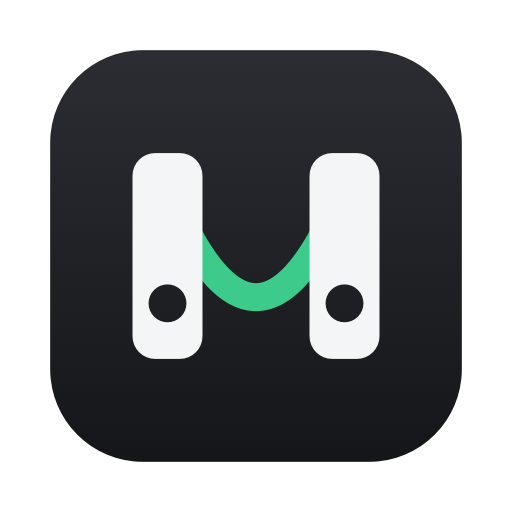
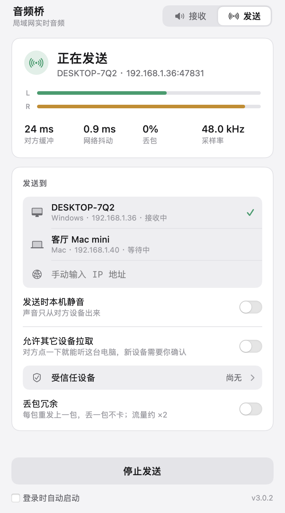
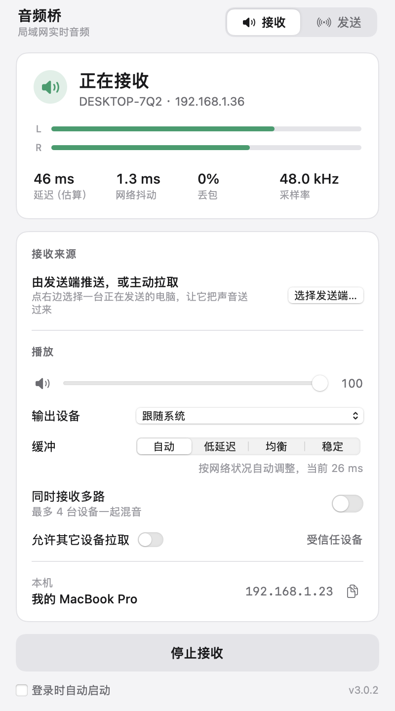
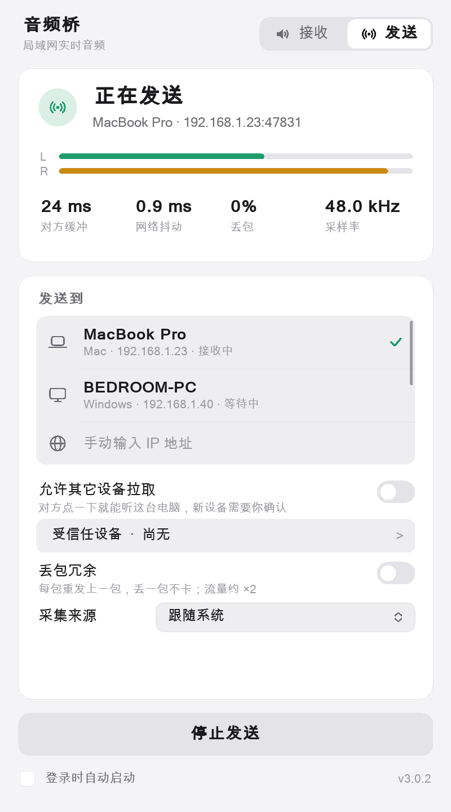
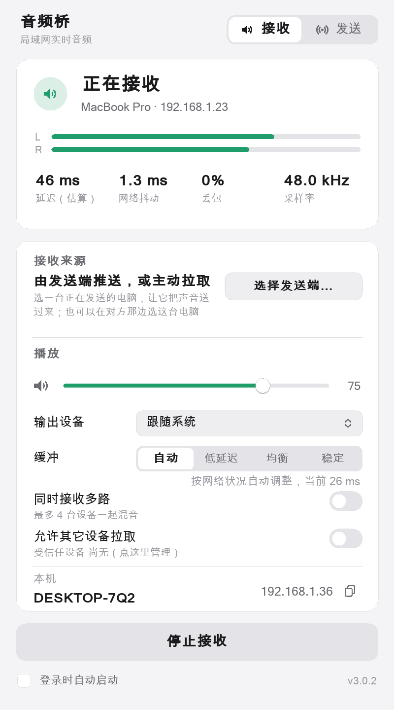

<div align="center">



# 音频桥 · Audio Bridge

**把一台电脑正在播放的声音，实时送到另一台电脑的扬声器或耳机。**

局域网 · 免驱动 · 不要管理员权限 · Mac / Windows 双向

[](#系统要求)
[](docs/DESIGN.md)
[](#从源码构建)
[](LICENSE)

</div>

**English** — Audio Bridge streams the audio a computer is playing to another computer on the same LAN, in real time. No virtual sound card, no drivers, no admin rights. There is one small GUI app for macOS (Swift + Core Audio Process Tap) and one for Windows (C# 5 + WinForms + WASAPI loopback); **either side can be sender or receiver**, so all four Mac↔Windows combinations work. Audio is 16-bit PCM over plain UDP, with optional packet redundancy and mixing of up to four incoming sources. A common use: turn a MacBook Pro (great speakers) into an external speaker for a desktop PC or a Windows box.

---

## 它解决什么问题

音频桥把**音源电脑上正在播放的一切**（浏览器、播放器、游戏、会议）当作输入，实时送到**另一台电脑的默认输出设备**。不需要虚拟声卡、不需要装驱动、不需要管理员权限，两台机器在同一个局域网就行。

- **把 MacBook Pro 当外置音箱用**——最划算的一种用法。MacBook Pro 的扬声器普遍好过显示器自带喇叭和多数入门桌面音箱（14/16 寸是六扬声器系统），把台式机、Windows 主机或旧笔记本的声音送过来，就多了一套现成的好音箱，MacBook Pro 的屏幕、键盘照常干自己的活。
- **显示器没喇叭**：画面在这台、声音从那台，不用另外买音箱。
- **客厅的音箱放卧室里的歌**：音源留在卧室电脑，声音从客厅那台出来。
- **两台电脑共用一副耳机**：哪台在放就切哪台，耳机只插一次。

四种组合都支持：**Mac → Mac、Mac → Windows、Windows → Mac、Windows → Windows**。哪一端当音源都行。

<p align="center">
  
  &nbsp;&nbsp;
  
</p>
<p align="center"><sub>macOS · 发送 / 接收</sub></p>

<p align="center">
  
  &nbsp;&nbsp;
  
</p>
<p align="center"><sub>Windows · 发送 / 接收 &nbsp;|&nbsp; 截图由程序自带的 <code>--snapshot</code> 渲染，设备名为演示数据，v3.0.2</sub></p>

---

## 特性

| 能力 | 说明 |
|---|---|
| **双向、角色可切** | 每一端都能当发送端或接收端，随时切换，不需要两套程序 |
| **自动发现** | 每秒广播信标，列出同一局域网里的设备和角色；广播被挡住时可直接填 IP |
| **低延迟** | 良好 Wi-Fi 下总延迟约 50–70 ms；缓冲四档（自动 / 低延迟 20 ms / 均衡 40 ms / 稳定 100 ms） |
| **抗抖动** | 接收端环形缓冲 + 异步重采样 + 时钟伺服，逐包吸收网络抖动，不靠「多缓冲」硬扛 |
| **丢包冗余** | 可选：每个音频包尾部附带上一包副本，丢一个包直接补回（流量约 ×2） |
| **多路混音** | 接收端可同时接收最多 4 台设备，逐路独立缓冲与重采样后混音输出 |
| **主动拉流** | 接收端可以「选择发送端…」把声音要过来；首次需对方确认，之后凭设备密钥静默通过 |
| **按程序采集** | Windows 10 2004+ 可只送某个程序的声音，通知音和其它程序不送；不支持时自动回退整机 |
| **常驻后台** | 关窗口只收进菜单栏 / 托盘；可登录时自启，开机自动连回上次的设备 |
| **会自愈** | 睡眠唤醒、切换输出设备、插拔耳机、对方重启、IP 变化、端口被占，都会自动重建链路 |

---

## 快速开始

### 系统要求

- **macOS 14.2 或更新**（系统声音采集依赖 Core Audio Process Tap）。只需要 Command Line Tools，不用装 Xcode。
- **Windows 10 / 11**（自带 .NET Framework 4，不用装 SDK）。按程序采集需要 Windows 10 2004 或更新。
- 两台电脑在**同一个局域网**（同一个路由器 / 同一个 Wi-Fi）。公司、酒店、校园网常开客户端隔离，那样两台机器彼此不通。

### macOS

```bash
git clone https://github.com/yuran123345678/monitor-audio-bridge.git
cd monitor-audio-bridge
./build.sh                     # 约半分钟，产出 build/MonitorAudioBridge.app
open build/MonitorAudioBridge.app
```

首次使用：

- **接收**：系统询问「允许查找本地网络设备」→ 允许。
- **发送**：系统询问「允许录制系统音频」→ 允许。拒绝也不报错，只是发出去是静音（界面会提示并给出授权路径）。
- 每次重新 `./build.sh` 是新的 ad-hoc 签名，系统可能会再问一次权限。
- 关窗口只是收进菜单栏；菜单栏图标 →「退出音频桥」才是真退出。

### Windows

把仓库里的 `windows/` 文件夹拷到 Windows，双击 **`启动.bat`**。

- 仓库不附带预编译的 exe；`启动.bat` 发现没有 exe 时会调用系统自带的 `csc.exe` 现编一个，几秒钟。之后直接双击 `AudioBridge.exe` 即可。
- 第一次运行 Windows 防火墙会询问 → 勾选「专用网络」→ 允许。不允许的话互相发现不了。
- 关了窗口只是收进右下角托盘；托盘图标右键 →「退出音频桥」。
- 改过 `.cs` 源码后，先从托盘退出，再双击 `重新编译.bat`。

### 连起来

1. **要出声的那台**切到「接收」（默认），状态显示「等待发送端」。
2. **音源那台**切到「发送」，在「发送到」列表里点对方的名字。
   列表是自动发现的；没出现就填对方界面上显示的本机地址，回车。
3. 状态变成「正在发送 / 正在接收」、电平表在跳，就通了。

之后两边都勾上「登录时自动启动」，开机即自动连回上次的设备。

### 把 MacBook Pro 当外置音箱

1. MacBook Pro 上打开音频桥，切「接收」，输出设备选「跟随系统」（就是它自己的扬声器）。
2. 台式机 / Windows 主机上打开音频桥，切「发送」，在「发送到」列表里点这台 MacBook Pro。
3. 台式机那边可以打开「发送时本机静音」，声音就只从 MacBook Pro 出来（Windows 发送端没有这个开关，把默认输出设到没接喇叭的口即可）。

MacBook Pro 不用做任何别的设置，发声的时候照常上网、写代码、看别的视频。

> 也可以反过来：让接收端点「选择发送端…」主动拉流，不用跑到另一台电脑前操作。见下方「主动拉流」。

---

## 使用要点

### 界面

两端布局相同：右上角切角色；状态卡显示状态、对端、L/R 电平表和四个指标；下面是接收 / 发送设置；底部是开始·停止、登录自启和版本号。

**指标怎么读**

- **延迟（估算）**：当前缓冲 + 输出设备延迟 + 约 10 ms 采集，不含网络传输本身（局域网通常 1–5 ms）。
- **网络抖动**：包到达时间的波动，长期大于 10 ms 说明 Wi-Fi 不太行。
- **丢包**：累计丢包率。
- 发送端看到的「对方缓冲 / 抖动 / 丢包」来自接收端回执，是**对方实际收到的情况**。

**缓冲档位**

| 档 | 值 | 适合 |
|---|---|---|
| 自动（默认） | 20–250 ms 动态 | 不想操心；按最近 10 秒最大包间隔估算，涨得快、降得慢 |
| 低延迟 | 20 ms | 游戏；两台都接网线，或 5 GHz 信号很好 |
| 均衡 | 40 ms | 一般 Wi-Fi |
| 稳定 | 100 ms | 网络差、只听音乐 |

### 主动拉流

接收端不必等对方来推，可以直接要：

1. 发送端确认「允许其它设备拉取」是开着的。
2. 接收端点「选择发送端…」，选一台设备，或手动输入 IP。
3. **第一次**对方会弹窗确认；允许后这台设备进入「受信任设备」，以后不再打扰，
   同时对方会把发送目标切到请求方（如果它当时是接收角色，会自动切成发送）。
4. 想停就点「取消拉取」，对方立刻停发并回到原来的角色 / 目标。

发送端可以整体关掉「允许拉取」，也可以在「受信任设备」里逐台或全部移除。拉流请求走发现端口，不新开端口。

### 其它

- **丢包冗余**：Wi-Fi 不稳时打开。每包多带一份上一包副本，丢一包直接补；连续丢两包以上仍会用「保持末值 + 淡出」兜底。
- **同时接收多路**：最多 4 台设备一起出声，混音时统一按 48 kHz 输出；某一路掉线只移除那一路，不打断其它。
- **按程序采集（Windows）**：发送端「采集来源」→「按程序采集…」，只送选中程序的声音。失败会自动回退整机采集并说明原因。
- **快捷键（Windows）**：`空格`/`回车` 开始·停止，`M` 静音，`←`/`→` 音量，`Esc` 收进托盘。
- **电平表颜色**：绿 = 正常，琥珀 = 高于约 −6 dB，红 = 贴顶（源头已削波）。

### 延迟与音画同步

总延迟 ≈ 采集（约 10 ms）+ 网络（1–20 ms）+ 接收端缓冲（20–100 ms）+ 输出设备自身延迟（Windows 约 20 ms）。
自动档在良好网络下一般落在 50–70 ms。

**画面在一台、声音从另一台出来时，声音会略晚**：看视频基本无感，快节奏游戏能感觉到，选「低延迟」并让两台都走 5 GHz 或网线。
蓝牙耳机自身还有 150 ms 以上的延迟，这个没法靠本程序解决。

---

## 工作原理

```
发送端
  ├─ 系统声音采集：macOS Core Audio Process Tap / Windows WASAPI loopback
  ├─ 切包：240 帧一包（约 5 ms）
  └─ 传输：UDP 47831 · 立体声 16-bit PCM
接收端
  ├─ 按来源分表，丢包隐藏 / 冗余补包
  ├─ RingBridge：环形缓冲 + 异步重采样 + 时钟伺服
  └─ 播放引擎 → 输出设备
```

- **音频面**：发送端把 PCM 切成 240 帧一包（约 5 ms）走 UDP；接收端用环形缓冲吸收抖动，重采样对齐到本机输出设备，时钟伺服把长期漂移压到 ±2.6 音分以内。
- **控制面**：两端每秒广播信标（设备名、角色、平台、能力位）；接收端每 0.5 s 回执（收包 / 丢包 / 抖动 / 缓冲）；退出时发「再见」，对方立即更新状态而不是等超时。
- **鉴权**：拉流首次配对由用户弹窗确认，发送端下发一次设备密钥；之后用「随机数 + HMAC-SHA256 截断 16 字节」证明持有密钥，密钥本身不再上线。请求、应答、再见都绑定来源 IP 与会话令牌。
- **端口**：音频 `47831/udp`，发现与控制 `47832/udp`。不新开端口，方便防火墙放行。

完整的协议字段表、超时阈值和每一项稳定性设计在 **[docs/DESIGN.md](docs/DESIGN.md)**。

---

## 从源码构建

### macOS

```bash
./build.sh
build/MonitorAudioBridge.app/Contents/MacOS/MonitorAudioBridge --nettest
```

`--nettest` 是静音自测，不需要第二台机器、不需要任何权限，可以随时跑；当前 **113 项全部通过**，覆盖保活 / 回执 / 音频流与重采样 / 再见 / 丢包乱序重复 / 序号回绕 / 畸形包 / 丢包冗余 / 多路混音 / 设备发现 / 受信任设备表 / 拉流四段握手与 22 项鉴权。

其它命令行工具：

```bash
B=build/MonitorAudioBridge.app/Contents/MacOS/MonitorAudioBridge
$B --snapshot /tmp/shots   # 界面各状态渲染成 PNG（README 里的截图就是这么来的）
$B --smoke                 # 把 收→发→停 的真实流程走一遍（会临时改偏好，结束后恢复）
$B --devices               # 列出音频设备
$B --recvnull 47831 10     # 对测：只收不放，打印统计
$B --send 192.168.1.20     # 对测：发 440 Hz 正弦
```

> `--selftest` 会**真的出声**（以 15% 音量播 3 秒 440 Hz），改音频路径时再跑。

### Windows

系统自带的 `csc.exe` 就能编，不需要 Visual Studio：

```bat
csc /nologo /codepage:65001 /optimize+ /target:winexe /win32icon:app.ico ^
    /out:AudioBridge.exe ^
    /r:System.dll /r:System.Core.dll /r:System.Drawing.dll /r:System.Windows.Forms.dll ^
    Protocol.cs Ring.cs Net.cs Wasapi.cs Model.cs Ui.cs Program.cs
```

或者直接双击 `windows/启动.bat`（没有 exe 时它会自己编），改源码后用 `重新编译.bat`。
自测：`AudioBridge.exe --selfcheck stage1 结果.txt`（另有 `stage2` / `control` / `redundancy` / `mix` / `capture` / `stress`）。

**为什么要用 C# 5 语法**：Win10/11 自带 .NET Framework 4 和 `csc.exe`，这样用户「拷过去就能跑」，不用装 SDK。代价是不能用 `$""`、`?.`、`out var` 这些新语法。

---

## 项目结构

```
monitor-audio-bridge/
├── Sources/                 macOS 端（Swift，无第三方依赖，swiftc 直接编）
│   ├── AppModel.swift       状态与调度：角色、启停、目标、自动缓冲、看门狗
│   ├── MainView.swift       SwiftUI 界面
│   ├── Protocol.swift       协议常量、封包 / 解包
│   ├── NetReceiver.swift    UDP 收包、多来源、丢包隐藏、回执
│   ├── NetSender.swift      切包发送、保活、静音门限
│   ├── SystemAudioTap.swift Core Audio Process Tap 采集
│   ├── PlayerEngine.swift   AVAudioEngine 播放与设备变化
│   ├── RingBridge.swift     环形缓冲 + 异步重采样 + 时钟伺服
│   ├── MixBus.swift         多路混音
│   ├── PullAuth.swift       拉流鉴权、质询表、会话
│   ├── Discovery.swift      广播信标与设备表
│   ├── Trust.swift          受信任设备与密钥
│   └── SelfTest.swift       --nettest / --selftest / --snapshot
├── Resources/               Info.plist、AppIcon.icns
├── windows/                 Windows 端（C# 5 + WinForms 自绘 + WASAPI）
│   ├── Model.cs             对应 AppModel.swift
│   ├── Ui.cs                自绘界面、托盘
│   ├── Net.cs               收 / 发 / 混音 / 发现
│   ├── Wasapi.cs            loopback 采集、播放、按程序采集
│   ├── 启动.bat             备用：没有 exe 时用系统 csc 现编
│   └── 用前必读.txt
├── scripts/                 图标生成、开发辅助脚本
├── docs/                    设计说明、变更记录、快速上手、截图
├── legacy/                  v1 的旧源码
└── build.sh                 macOS 一键编译
```

两端是**同一套逻辑的两份实现**：协议字段、状态文案、超时阈值、缓冲算法改一边就要同步另一边。

---

## 项目状态

这是一个个人项目，按「自己天天用」的标准写。验证到哪一步，就如实写到这里：

- **macOS 端**：编译通过，`--nettest` 113 项全绿；界面各状态已用 `--snapshot` 逐张看过。系统声音采集依赖首次授权，记得在弹窗里允许「录制系统音频」。
- **Windows 端（Windows 10 实机）**：整机采集发送、接收出声、按程序采集（Process Loopback）、主动拉流与受信任设备都已实测正常；`--selfcheck` 七组全过，`csc` 编译 0 错误 0 警告。
- **跨端**：Windows 与 macOS 之间的发送 / 接收、主动拉流已实测跑通。多路混音（4 路同时接收）目前只有本机自测覆盖，建议自己再验一遍。

遇到问题先看日志：macOS 是 `~/Library/Application Support/MonitorAudioBridge/`，Windows 是 `%APPDATA%\AudioBridge\error.log`。

---

## 已知限制

- **只在可信局域网使用**。音频是**明文 UDP、不加密**，同一局域网里知道协议的人可以往接收端推声音；拉流的设备密钥只做「授权」，不是加密传输。
- 发现靠广播，**过不了路由器、VPN、Tailscale，也过不了开了 AP 隔离的公共 Wi-Fi**；AP 隔离下即使手动填 IP 也不通。
- 16-bit 传输。量化底约 −96 dB，实际听不出，但不是 24/32-bit 无损。
- 多声道（5.1 / 7.1）只取前左、前右，不做降混。
- 混音最多 4 路，且混音时统一 48 kHz 输出（44.1 kHz 来源会重采样）。
- Windows 发送端没有「本机静音」：loopback 抓的就是那个播放设备上的声音。变通办法是把默认输出改成显示器 HDMI，再把显示器音量拧到 0。
- 按程序采集只在 Windows 10 2004+ 可用，失败会自动回退整机采集。
- Windows 界面是 GDI+ 自绘，对读屏软件不友好；macOS 端用的是标准 SwiftUI 控件。
- 协议当前为 **v5**，与 3.0.1 及更早版本**不互通**，两端必须一起升级。

---

## 文档

| 文档 | 内容 |
|---|---|
| [docs/DESIGN.md](docs/DESIGN.md) | 架构、协议字段表、稳定性设计、踩过的坑（最详细） |
| [docs/QUICKSTART.md](docs/QUICKSTART.md) | 两分钟上手、验证命令、已知限制 |
| [docs/CHANGELOG.md](docs/CHANGELOG.md) | 版本记录：每一项改了什么、为什么 |
| [windows/用前必读.txt](windows/用前必读.txt) | 给 Windows 用户的短说明 |

---

## 许可

[MIT](LICENSE)。可以自由使用、修改、分发，包括商用，保留版权声明即可。

如果它对你有用，点个 Star 就好。有问题或建议欢迎开 Issue。
